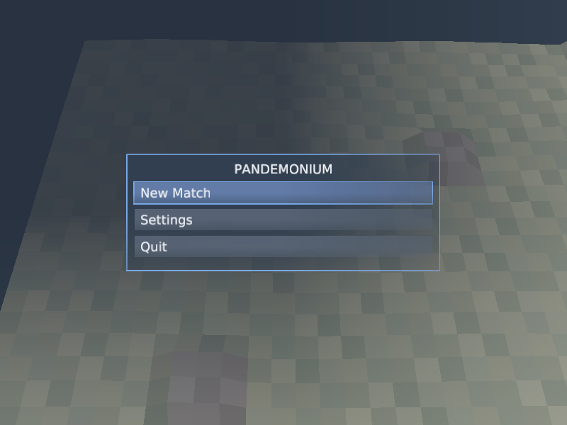
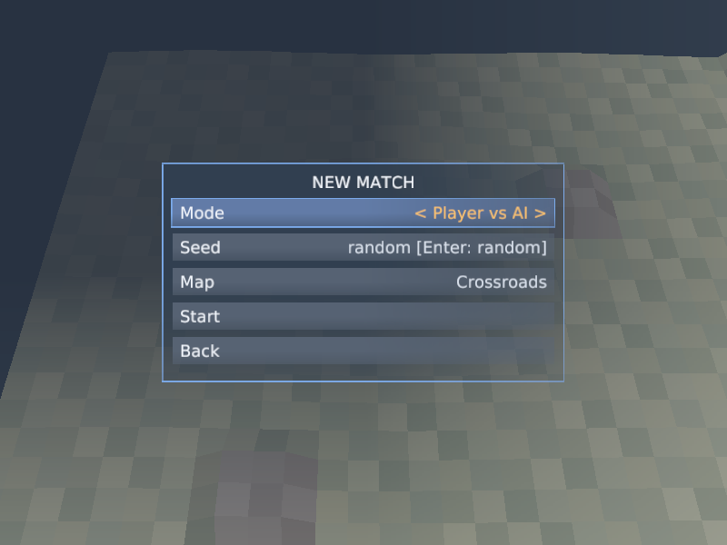
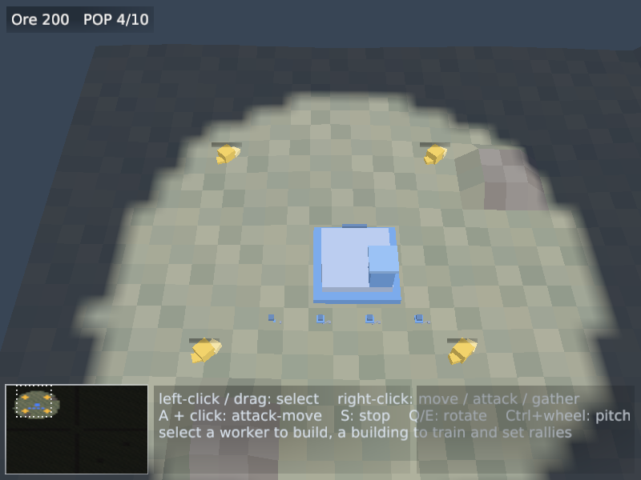
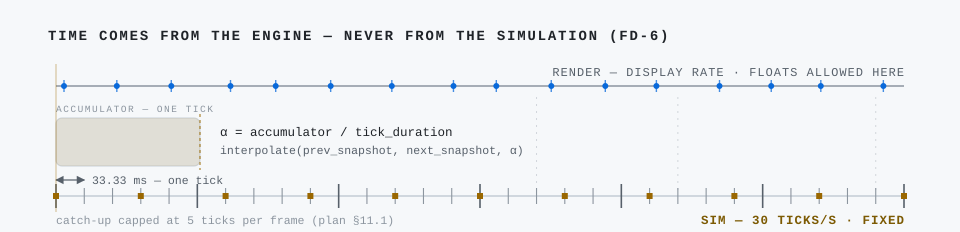
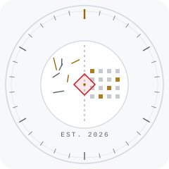

<div align="center">

<picture>
  <source media="(prefers-color-scheme: dark)" srcset="readme-assets/hero-dark.svg">
  
</picture>

# Pandemonium: Build & Destroy

**A deterministic real-time strategy game — engine, simulation, and client —
written from scratch in Rust.**

No game engine, no ECS framework, no off-the-shelf simulation. The game loop,
the entity store, the fixed-point math, the replay codec: all of it is ours.

`30 Hz fixed tick` · `Q16.16 fixed-point` · `PCG32` · `xxHash64` · `9 crates · 0 floats`

[](https://github.com/E-Vex/pandemonium-bd/actions/workflows/ci.yml)
[](https://github.com/E-Vex/pandemonium-bd/releases)
[](rust-toolchain.toml)
[](docs/ALPHA_DECLARATION.md)
[](tests/architecture_law.rs)
[](LICENSE)

*The name promises chaos. The simulation declines to deliver it.*

</div>

---

## Contents

- [About](#about)
- [The Determinism Guarantee](#the-determinism-guarantee)
- [Quick start](#quick-start)
- [Screenshots](#screenshots)
- [Gameplay](#gameplay)
- [Controls](#controls)
- [Architecture](#architecture)
- [Engineering practices](#engineering-practices)
- [Reporting bugs](#reporting-bugs)
- [Project status](#project-status)
- [Documentation](#documentation)
- [Contributing](#contributing)
- [Security](#security)
- [License](#license)

## About

Pandemonium: Build & Destroy is a real-time strategy game — harvest ore, raise
a base, train an army, destroy the enemy — built on a simulation whose
distinguishing engineering property is **bit-exact determinism**. The entire
stack is custom: a nine-crate Rust workspace covering fixed-point math, the
simulation core, content loading, AI, replays, the engine loop, and a wgpu /
winit 3D client. Nothing is borrowed from a game engine, an ECS framework, or
a third-party simulation.

Determinism is not a side effect here; it is the product. A match is exactly
three things — a seed, a content hash, and an ordered command log — and
replaying those three anywhere reproduces every tick checksum, bit for bit.
That property is what makes verified replays, soak testing, and future
lockstep multiplayer fall out of the architecture instead of being bolted on.

| | |
|---|---|
| **Determinism is the product** | A match is a seed, a content hash, and an ordered command log. Replay those three anywhere and every tick checksum matches — bit for bit, tick for tick. |
| **Everything is ours** | The game loop, the entity store, the Q16.16 fixed-point math, the PCG32 RNG, the xxHash64 state hash, the replay codec. No engine, no ECS, no shortcuts. |
| **Content is data** | Units, maps, factions, rulesets, missions, campaigns: strict, versioned RON. Adding one touches zero lines of engine code (FD-4). |
| **Trust is enforced, not promised** | No floats, no unordered maps, no wall-clock, no OS entropy anywhere in the simulation — enforced by lints *and* a source-scanning test (FD-5). |

The project is currently at the **Alpha** stage: two factions, one authored
battlefield, a pilot campaign — and a simulation foundation judged by system
properties, not content volume. Expect the architecture to be more settled
than the content.

## The Determinism Guarantee

> **THE DETERMINISM GUARANTEE** — issued with every build, honored on every
> machine.
>
> 1. A match is exactly three things: **a seed, a content hash, and an ordered
>    log of commands.** Nothing else participates.
> 2. Replayed anywhere — any OS, any compiler, debug or release — **every
>    checkpoint checksum shall match**, tick for tick.
> 3. Units may scatter. **The simulation does not.** If two runs of the same
>    inputs ever differ, that is not a feature and not an edge case — that is
>    a defect, and you file it.
>
> *Sealed by three golden hashes, re-verified bit-identical on every push, on
> three operating systems, in both build profiles.*

Every claim is falsifiable — that is the point. The fastest attempted
refutation is a shell session:

```bash
git clone https://github.com/E-Vex/pandemonium-bd && cd pandemonium-bd

# simulate 300 ticks at seed 7, every checkpoint printed
cargo run -p pandemonium-tools -- headless --seed 7 --ticks 300
#   final state hash: 0xb6fff6659cfb7709        <- the demo golden

# record the match, then re-simulate it and compare every checkpoint
cargo run -p pandemonium-tools -- headless --seed 7 --ticks 300 --record demo.pdrp
cargo run -p pandemonium-tools -- replay-verify demo.pdrp
#   verify pass                                 <- the match happened twice, identically
```

Run it on the strangest machine you own. **The golden hash is a standing
challenge:** if your run disagrees with it, you have not found an edge case —
you have found the most valuable bug report this project can receive.

The three golden values, and the commands that reproduce them:

| golden | command | value |
|---|---|---|
| **demo** | `headless --seed 7 --ticks 300` | `0xb6fff6659cfb7709` |
| **flagship** | `headless --seed 7 --ticks 7200 --p1 ai --p2 ai` | `0x3a58e55ea6250906` (tick 0: `0x090a57e33cdf4c4b`) |
| **content identity** | `content-validate content` | `0x4d362e1a17b9eefc` (map id `0xd38136401ab02ff1`) |

A fourth command shows a full AI-vs-AI match resolving naturally end to end:

```bash
cargo run -p pandemonium-tools -- headless --seed 7 --ticks 27000 --p1 ai --p2 ai
```

## Quick start

### Requirements

- **Rust 1.98.1**, pinned exactly by [`rust-toolchain.toml`](rust-toolchain.toml);
  rustup installs it automatically on first use.
- **Linux:** `libasound2-dev` for the client's audio stack
  (`sudo apt-get install libasound2-dev`); macOS and Windows need no system
  library.
- **A GPU** with Vulkan / Metal / D3D12 support (wgpu). Software rendering
  works too — CI verifies the windowed client under Xvfb + llvmpipe.

### Run a release build

Pre-built archives are published on the
[releases page](https://github.com/E-Vex/pandemonium-bd/releases) —
**v0.1.1** is the current pre-release (the Alpha playtest build): per-OS
archives for Linux, Windows, and macOS with SHA-256 checksums, licence
notices, and the official art pack bundled. Unpack anywhere and run
`pandemonium-client` — see the bundled
[`QUICKSTART.md`](docs/product/QUICKSTART.md). Building from `master` is
ahead of the release (missions, campaign, save & resume, the glTF model
pipeline).

### Build from source

```bash
git clone https://github.com/E-Vex/pandemonium-bd && cd pandemonium-bd
cargo run -p pandemonium-client        # the windowed client, main menu first

# optional: the official art pack (E-Vex/pandemonium-assets) — one command,
# idempotent; without it the client falls back to placeholder rendering
scripts/fetch-assets.sh
```

### Command-line reference

| invocation | effect |
|---|---|
| `cargo run -p pandemonium-client` | windowed client, main menu first |
| `cargo run -p pandemonium-client -- --frames 900` | windowed smoke test: auto-exit with an evidence summary |
| `cargo run -p pandemonium-client -- --headless` | no display? honest fallback, no theater |
| `cargo run -p pandemonium-client -- --version` | the build identity line: `pandemonium-client 0.1.1 (git <sha>, content 0x4d362e1a17b9eefc)` |
| `cargo run -p pandemonium-client -- --content PATH` | point at a content tree explicitly |
| `cargo run -p pandemonium-client -- --seed N` | pre-fill the New Match screen's seed field |
| `cargo run -p pandemonium-client -- --record run.pdrp` | record a replay alongside the session |

The main menu starts a match (**Player vs AI / AI vs AI spectate / Sandbox**)
or the campaign, remembers your seed and map choices within the run, and
persists settings across runs — `edge_scroll`, `pan_speed`, `zoom_min`,
`zoom_max`, `master_volume`, `muted`, `fullscreen`, `debug_overlay` — in a
small `key=value` file in your user config directory. Without `--seed`, the
seed is random *and shown*, so you can still report it.

Audio degrades, never blocks: a machine with no output device gets one honest
startup line and a silent game; every other system runs normally
(`PANDEMONIUM_AUDIO_PROBE=0` skips the probe).

### The green gate

The same gate CI runs on every push, on three operating systems, in both
profiles:

```bash
cargo build --workspace --release
cargo fmt --all -- --check
cargo clippy --workspace --all-targets -- -D warnings
cargo test --workspace
cargo test --workspace --release     # determinism must hold in release too
```

## Screenshots

Real captures from the client (Xvfb + software GL) — the main menu, the match
setup screen, and a match in progress:

<p align="center">



</p>

## Gameplay

### The Legion

**The Legion** — a command center, four workers, one resource (200 ore in
the bank), and victory by elimination. Every number below is data in
[`content/`](content), not code; check it yourself with
`cargo run -p pandemonium-tools -- content-validate content`.

**The field roster**

| unit | doctrine | ore | pop | the numbers that matter |
|---|---|---:|---:|---|
| **Worker** | the economy — gathers ore, raises structures | 50 | 1 | 2.6 tiles/s |
| **Rifleman** | line infantry — holds the middle | 75 | 1 | dmg 8 · range 5.0 · 1.0 s reload |
| **Raider** | the flanker — arrives first | 60 | 1 | 4.0 tiles/s · dmg 6 · range 1.5 · 0.6 s reload |
| **Guardian** | the slow hammer | 200 | 3 | dmg 30 · range 8.0 · 2.0 s reload |
| **Pathfinder** | the eyes — fastest thing on the field, longest sight | 50 | 1 | 6.0 tiles/s · sight 12.0 · dmg 4 · range 3.0 |
| **Lancer** | the anti-armor answer — one heavy piercer per slow cycle | 160 | 2 | dmg 60 · range 6.0 · 2.5 s reload |
| **Ballista** | the siege answer — outranges everything, turrets included | 275 | 3 | dmg 60 · range 12.0 · 4.0 s reload · 1.2 tiles/s |
| **Turret** | static denial | 125 | 0 | dmg 10 · range 7.0 · 1.0 s reload |

**The infrastructure**

| structure | ore | provides |
|---|---:|---|
| **Command Center** | 400 | the HQ — trains Workers, +10 population |
| **Barracks** | 150 | the first tier — trains Rifleman, Raider, Guardian |
| **Forge** | 250 | the second tier — trains the arsenal: Pathfinder, Lancer, Ballista |
| **Supply Depot** | 100 | +10 population |

The second tier is the game's first tech decision: the Forge requires a
Barracks, and its three kinds each require the Forge — a player who techs
gains the counter shapes (Lancer into Guardian, Ballista into static
defense) at the price of the raw army the same ore would have fielded. The
scripted Alpha opponent fields only the first tier; the arsenal is the
player's edge (and the balance's open question — it rides the playtest).

**The maps**

| map | size | role |
|---|---|---|
| **Crossroads** | 64×64 | the authored battlefield — mirrored starts, a central choke, contested ore |
| **Iron Basin** | 72×72 | the basin — four ramps into a buildable, ore-rich center; three lanes around the ridge arms |
| **Verdant Frontier** | 96×96 | the larger field |
| **Proving Grounds** | 128×128 | the 10× scale stress arena ([`content_scale/`](content_scale)) |

The Legion's sparring partner, **the Swarm**, is not a faction — it is an
instrument: the same roster at 1,000 starting forces per side on the Proving
Grounds, for the scale row of the stress tests. The stress test fights back.

### The Phalanx

**The Phalanx** (B-032, plan §19's Update 5) is the second faction — the
anvil to the Legion's combined arms. It builds the same infrastructure but
trains none of the Legion's soldiers: fewer, slower, costlier bodies that
win the ground they stand on and lose the ground they are not standing on.
The same command center, three workers, and the two hoplites the faction is
named for; the shared buildings; the counter-web below is measured by
`tests/balance.rs` (the battery's P-laws) and authored, not yet playtested.

**The anvil roster**

| unit | doctrine | ore | pop | the numbers that matter |
|---|---|---:|---:|---|
| **Hoplite** | the anvil line — one hp per ore on the field's slowest legs | 120 | 2 | hp 120 · dmg 14 · range 3.5 · 1.1 s reload |
| **Onager** | the light engine — out-reaches the turret by half a tile | 110 | 1 | dmg 44 · range 7.5 · 4.0 s reload · hp 60 |
| **Cataphract** | the shock — the one fast thing the anvil fields | 240 | 3 | hp 260 · 2.6 tiles/s · dmg 24 · range 3.0 |
| **Colossus** | the walking fortress | 400 | 6 | hp 520 · dmg 80 · range 6.5 · 3.0 s reload |

The web is a cycle, not a ladder: hoplites beat the Legion's line and swarm,
the Legion's anchor and piercer beat the anvil, the colossus beats the
anchor, and the piercer and the swarm beat the colossus. The onager dismantles
static defense from outside its reach (the Ballista's trick at one-third the
price) and dies to anything that closes — the battery's P11 timing law has
it flattening a command center in ~484 ticks where equal-ore riflemen need
~795. The Phalanx debuts in the campaign's fourth chapter, **The Anvil**
(`anvil_01`, Iron Basin), playable through the mission picker the same way.

### Active abilities

The ability system ([ADR-0202](docs/adr/0202-ability-system.md)) is the
foundation's first designed extension (plan §19's Update 6): one capability
block per kind, one verb through the shared command gate, and a closed
code-defined effect vocabulary that data only parameterizes.

| carrier | ability | effect | cooldown |
|---|---|---|---|
| **Pathfinder** | Overland Sprint | 1.5× move speed for 4 s in a 2.5-tile radius | 20 s |
| **Ballista** | Shatter Volley | 45 damage in a 1.8-tile radius, cast range one tile beyond its own sight | 25 s |

The Volley's cast range outruns the Ballista's own vision on purpose: the
gate refuses a target point the caster's side cannot see, so the pairing
this roster always promised — **the Pathfinder spots, the Ballista shells** —
is now the play. Click an ability button, click the ground; the crosshair,
Escape/right-click cancel, and the cooldown sweep follow the attack-move
family's rules. The numbers are authored, not playtested — the feel rides
the A14 sessions with the rest of the balance.

### Missions & campaign

The mission and campaign model ([ADR-0201](docs/adr/0201-missions-campaigns-cutscenes.md))
is complete and shipped end to end:

- **Missions** are a versioned content class with objective sets — survive,
  reach, protect, gather, and "grow to N" kinds, optional objectives,
  restrictions, and AI settings — evaluated as derived state at stage 10 of
  the tick, never hashed into the match identity.
- **The pilot campaign** — *Alpha Campaign*: three chapters in play order
  plus one challenge, all on Crossroads, with escalation coming from the
  objective sets. Chapters unlock on completion *or* skip; the challenge
  unlocks on completing its chapter. Progress persists in
  `campaign_progress.cfg`.
- **The client half**: the campaign screen, the mission picker, the
  objectives HUD (<kbd>Tab</kbd>), a start cutscene, and the mission end
  screen with victory recording.
- **Replays carry the mission identity**: `replay-verify` re-simulates
  mission-carrying records and refuses a record against content that does not
  carry its mission — before any tick is spent.

### Save & resume

Mid-mission save is live (ADR-0201 Phase 4): a single `mission_save.pdrp`
slot beside `settings.cfg` — which *is* a replay record, written by the same
recorder `--record` uses. The pause menu's confirm-gated **Save & Quit** and
the main menu's **Continue** row resume through the record's own seed and
setup, rehosted via `MatchHost::resume_with_mission`, entering unpaused with
the HUD seeded from the authoritative statuses.

### Presentation: art & audio

- **3D over 2D** — a perspective 3D renderer over the 2D logical ground
  plane; the simulation stays 2D fixed-point, and 3D is presentation-only
  ([ADR-0001](docs/adr/0001-3d-presentation.md)).
- **The model pipeline** ([ADR-0101](docs/adr/0101-model-pipeline.md)) —
  glTF static meshes per entity kind with team-color tinting, pack manifest
  schema 2, and a fallback chain (model → skin → placeholder) that never
  breaks a build or a match.
- **The art is separate data** ([ADR-0200](docs/adr/0200-authoritative-vs-presentation-data.md)):
  the official `tactical_field` pack lives in its own repo
  ([E-Vex/pandemonium-assets](https://github.com/E-Vex/pandemonium-assets)),
  never enters the content hash, and rides in every release archive — one
  command for developers: `scripts/fetch-assets.sh`.
- **Audio** ([ADR-0002](docs/adr/0002-rodio-audio-backend.md)) — rodio
  behind a nine-cue `AudioSink` seam; degrades to a null sink, never blocks.

## Controls

Controls follow **Generals: Zero Hour muscle memory** — a Zero Hour player
sits down and every binding they try works.

**Selection** — *left never issues an order*

| input | effect |
|---|---|
| <kbd>Click</kbd> / <kbd>Left-drag</kbd> | select / box-select |
| <kbd>Click</kbd> empty ground | deselect |
| <kbd>Shift</kbd>+<kbd>Click</kbd> / <kbd>Drag</kbd> | add (never remove — removal is a re-select) |
| <kbd>Double-click</kbd> / <kbd>E</kbd> | select the same-kind units on screen (double-tap <kbd>E</kbd>: every visible one on the map) |
| <kbd>Q</kbd> | select all combat units on screen (double-tap: every visible one on the map) |
| <kbd>Ctrl</kbd>+<kbd>←</kbd>/<kbd>→</kbd>, <kbd>Ctrl</kbd>+<kbd>↑</kbd>/<kbd>↓</kbd> | cycle units / workers (one at a time, wrapping) |
| <kbd>Esc</kbd> | clear the selection (the ladder's rung — see below) |

**Command** — *right is the only way to order*

| input | effect |
|---|---|
| <kbd>Right-click</kbd> enemy / ore node / ground | attack / gather (workers) / move |
| <kbd>Right-click</kbd> a single selected producer | set the rally point |
| <kbd>A</kbd> | arm attack-move for the next left-click |
| <kbd>S</kbd> | stop |
| <kbd>G</kbd> | arm guard for the next left-click (a move; on arrival the unit stands and engages in-range targets) |
| <kbd>X</kbd> | scatter (each selected unit hops one ring-ray out) |
| <kbd>Alt</kbd>+<kbd>Click</kbd> | waypoints — the first click replaces the in-flight order, each later click queues it |
| <kbd>Ctrl</kbd>+<kbd>Click</kbd> | force-fire — **not yet available** (planned) |

A click under 6 px of travel orders; a right-drag beyond that grabs and
scrolls the map instead, and the release then orders nothing.

**Camera**

| input | effect |
|---|---|
| <kbd>Arrows</kbd> / screen edges / <kbd>Right-drag</kbd> | scroll |
| <kbd>Middle-drag</kbd> / <kbd>Numpad 4</kbd>/<kbd>6</kbd> | rotate |
| <kbd>Wheel</kbd> / <kbd>Numpad 8</kbd>/<kbd>2</kbd> | zoom (toward the cursor / at the view center) |
| <kbd>Ctrl</kbd>+<kbd>Wheel</kbd> | tilt the pitch |
| <kbd>Numpad 5</kbd> | reset the camera (yaw, pitch, distance) |
| <kbd>F1</kbd>–<kbd>F8</kbd> / <kbd>Ctrl</kbd>+<kbd>F1</kbd>–<kbd>F8</kbd> | jump to / set a camera bookmark |

**Groups, jumps & interface**

| input | effect |
|---|---|
| <kbd>1</kbd>–<kbd>0</kbd> / <kbd>Ctrl</kbd>+<kbd>1</kbd>–<kbd>0</kbd> | recall / assign a control group; double-tap centers on it |
| <kbd>Alt</kbd>+<kbd>1</kbd>–<kbd>0</kbd> | view a group (camera only, selection untouched) |
| <kbd>Space</kbd> | jump to the last radar event — a death or an attack on your forces — or your base |
| <kbd>H</kbd> | jump to your Command Center |
| <kbd>F9</kbd> | toggle the command bar (minimap included) |
| <kbd>Tab</kbd> | toggle the mission objectives panel (missions only) |
| <kbd>Esc</kbd> | climb one rung per press: armed command → placement → selection → **pause menu** (Resign and Save & Quit live there, confirm-gated) |
| <kbd>P</kbd> · <kbd>.</kbd> · <kbd>R</kbd> | pause · single-step (paused) · rematch |
| <kbd>F10</kbd> · <kbd>F11</kbd> · <kbd>F12</kbd> | debug overlay · bug-report dump · screenshot — **F12 not bound** |

The tester-facing copy of this card — and the playtest protocol around it —
is [`docs/PLAYTEST.md`](docs/PLAYTEST.md).

## Architecture

<p align="center">
<picture>
  <source media="(prefers-color-scheme: dark)" srcset="readme-assets/architecture-dark.svg">
  
</picture>
</p>

Nine crates, one law: **dependencies point downward only, and `sim` depends on
nothing above it.** [`tests/architecture_law.rs`](tests/architecture_law.rs)
makes breaking that a build failure, not a conversation — it checks the
internal edge allow-list, per-crate external dependency allow-lists, a
forbidden-crate list (bevy, ECS frameworks, rapier, `rand`/`getrandom`, …),
and scans the determinism crates for unordered-map types, wall-clock reads,
and floating-point type names.

| crate | role |
|---|---|
| [`fx`](crates/fx) | fixed-point math (`Fx`, `Vec2Fx`, `isqrt`), PCG32 RNG, xxHash64 hasher |
| [`sim_api`](crates/sim_api) | the boundary vocabulary: `Command`, `Event`, `Snapshot`, `PlayerView`, `Reject`, the mission vocabulary |
| [`sim`](crates/sim) | the simulation: the 11-stage tick pipeline, stores, the command gate, the state hash, the mission objective evaluator |
| [`content`](crates/content) | RON schema, versioned loaders, validators, `ContentBundle`, the mission content class |
| [`ai`](crates/ai) | the scripted Alpha opponent — commands only, through a fog-filtered view |
| [`replay`](crates/replay) | the checksummed replay codec: record, load, verify (mission-aware) |
| [`engine`](crates/engine) | game loop, interpolation, `MatchHost`, camera, mesh, renderer + audio seams |
| [`client`](crates/client) | the playable binary: wgpu + winit, 3D renderer, HUD, menus, campaign & save surfaces, audio |
| [`tools`](crates/tools) | headless runner, replay verifier, content validator, soak, bench, diff-check |

The heartbeat, as a diagram:

<p align="center">
<picture>
  <source media="(prefers-color-scheme: dark)" srcset="readme-assets/timestep-dark.svg">
  
</picture>
</p>

Thirty ticks per second, every second, decoupled from rendering. The engine
interpolates between snapshots so the picture is smooth; the simulation never
learns what a frame rate is. All intent — player, AI, replay, future network —
enters through one validated `Command` gate at tick boundaries (FD-2). Parity
is a compile error, not a policy. The full specification is
[`plan.md`](plan.md); the code-as-built map is
[`docs/ARCHITECTURE.md`](docs/ARCHITECTURE.md).

<details>
<summary><b>The Law — the ten frozen decisions (FD-1 … FD-10)</b></summary>

The constitution of the project ([`plan.md`](plan.md) §2). Changing one takes
an [ADR](docs/adr/README.md) with evidence — never a silent edit.

| | the law | what it buys |
|---|---|---|
| **FD-1** | deterministic fixed-tick simulation, 30 Hz, decoupled from rendering | a match = seed + content hash + command log; replays, soaks, lockstep multiplayer follow |
| **FD-2** | all intent enters as validated `Command` records at tick boundaries | one door for players, AI, replays, future network |
| **FD-3** | unified entity model: base record + capability blocks; 64-bit monotonic IDs, never reused | new entity types are data; systems iterate by capability, never by type name |
| **FD-4** | strict data/code boundary — stats, costs, maps, factions are versioned data files | add-a-unit and add-a-map require zero engine changes |
| **FD-5** | no floating point in the simulation or content — fixed-point / integer only | bit-identical results across OS, CPU, and compiler versions |
| **FD-6** | the simulation depends on nothing above it — no renderer, window, audio, clock, filesystem, OS entropy | the presentation layer is swappable without touching rules |
| **FD-7** | the AI plays through commands and a fog-filtered `PlayerView` | parity is structural, not a policy |
| **FD-8** | fog filters information; it never alters the simulation | replays and the AI stay honest |
| **FD-9** | events flow outward; presentation never polls sim internals | the feedback layer grows without sim changes |
| **FD-10** | the content schema only moves forward: versioned, validated, old content keeps loading | content survives years of growth |

</details>

## Engineering practices

**The green gate.** CI runs on every push and pull request: `rustfmt --check`,
`clippy -D warnings` (zero tolerance), and the full test suite in **both dev
and release profiles on Linux, Windows, and macOS** — determinism must hold
in release and across platforms. A replay round-trip job records a scripted
match and verifies it, and a `content-identity` job pins the content hash and
map id executably. Runner images are pinned to explicit versions so the
cross-OS hash evidence never shifts under a silent runner bump. A nightly
workflow adds the soak tier (1000-match shards plus the plan §15 performance
budgets); `audit` and `deny` workflows gate advisories and licences.

**The numbers.**

| | |
|---|---|
| **Tests** | 1043 dev / 1038 release, green in both profiles (the five should-panic invariant tests are debug-only) |
| **Platforms** | Linux · Windows · macOS — the full gate on every push, both profiles |
| **Goldens** | demo `0xb6fff6659cfb7709` · flagship `0x3a58e55ea6250906` · content `0x4d362e1a17b9eefc` — moved four times, each by an authorized move: B-029's growth, B-031's stat rebalance, B-032's second faction (behavior-identical for the Legion: the same 612 commands, the same RNG streams, only the re-labeled kind ids moved), and B-033's ability content (the Pathfinder's Sprint and the Ballista's Volley — again behavior-identical for every pinned run: the carriers are forge-tier, no scripted AI fields them, so the demo and flagship hashes are bit-identical and only the content digest moved); the map growth passes (B-030 on) move none of them |
| **Soak** | many seeded AI-vs-AI matches with per-match crash isolation; a dev-profile soak observes the invariant checker (A12) |
| **Releases** | per-OS archives, SHA-256 checksums, a licence gate (cargo-deny) and generated `THIRD_PARTY_NOTICES.md`, and smoke legs that gate on the licence and the bundled art pack |

A golden value moves only by the owner's explicit authorization, in one
dedicated commit that updates every pinned location (the CI values, the test
pins, and the status board) and re-derives old and new values live. Anything
else is a stop-and-report failure.

**The process.** Milestones are gates, not dates: M(N+1) does not start until
every exit test of M(N) is green in CI. Deliberate simplifications are
registered in [`docs/DEBT.md`](docs/DEBT.md) with a repayment trigger; guessed
interpretations in [`docs/ASSUMPTIONS.md`](docs/ASSUMPTIONS.md); challenges to
frozen decisions go through an [ADR](docs/adr/README.md). Every claim in this
README has an automated test or a CI job behind it — the project's rule is
"prove, don't assert".

## Reporting bugs

A report that includes the seed and the tick is a **reproducible incident**;
anything else is anecdote. The windowed client writes the report for you:
press <kbd>F11</kbd> at (or right after) the moment of the problem and it
drops a replay record (`pandemonium-report-<seed>-tick<tick>.pdrp`) plus a
sidecar `…-info.txt` carrying the seed, the tick, and the content identity.
Attach both files to the issue; the replay re-verifies headlessly:

```bash
cargo run -p pandemonium-tools -- replay-verify <file>
```

## Project status

| | |
|---|---|
| **Stage** | Alpha development — the mission/campaign/save chapter ([ADR-0201](docs/adr/0201-missions-campaigns-cutscenes.md)) and the M12 model pipeline ([ADR-0101](docs/adr/0101-model-pipeline.md)) are complete; the ability system ([ADR-0202](docs/adr/0202-ability-system.md), proposed) has landed as plan §19's Update 6 |
| **Open gate** | **A14, the human playtest** — five first-time tester slots, the protocol in [`docs/PLAYTEST.md`](docs/PLAYTEST.md) — is the last open gate of the Alpha declaration |
| **Latest release** | [v0.1.1](https://github.com/E-Vex/pandemonium-bd/releases) (pre-release, the Alpha playtest build); `master` is ahead — build from source for missions, campaign, save & resume, and glTF models |
| **Next** | A14 → the Alpha declaration ([`docs/ALPHA_DECLARATION.md`](docs/ALPHA_DECLARATION.md)) → post-Alpha content growth |

The live status board is [`AI-Handoff.md`](AI-Handoff.md) — an out-of-date
handoff is treated as a bug. The Alpha's *system* properties are declared
proven with evidence in
[`docs/ALPHA_DECLARATION.md`](docs/ALPHA_DECLARATION.md); the playtest decides
the human half.

## Documentation

| document | role |
|---|---|
| [`AI-Handoff.md`](AI-Handoff.md) | **start here** — the live status board, verification commands, hard-won gotchas |
| [`plan.md`](plan.md) | the authoritative spec (v2.0): FD-1..10, determinism rules, milestones, acceptance A1–A15 |
| [`docs/ALPHA_DECLARATION.md`](docs/ALPHA_DECLARATION.md) | the acceptance sweep A1–A15 with evidence; A14's open finding |
| [`docs/PLAYTEST.md`](docs/PLAYTEST.md) | the A14 instrument: protocol, controls card, tester schedule and results |
| [`docs/product/GAP_ANALYSIS.md`](docs/product/GAP_ANALYSIS.md) | the product-surface audit: the player journey vs the shipped client, and the ordered R1 gap list |
| [`docs/product/QUICKSTART.md`](docs/product/QUICKSTART.md) | the player-facing quickstart card that ships in every release archive |
| [`docs/ARCHITECTURE.md`](docs/ARCHITECTURE.md) | the working map of the code as built |
| [`docs/ASSETS.md`](docs/ASSETS.md) | the art pipeline: the brain/body split, pack layout, the official pack |
| [`docs/CONTENT_GUIDE.md`](docs/CONTENT_GUIDE.md) | content authoring reference |
| [`docs/DEBT.md`](docs/DEBT.md) | every deliberate simplification, each with a repayment trigger |
| [`docs/ASSUMPTIONS.md`](docs/ASSUMPTIONS.md) | every interpretation that had to be guessed, numbered and cited |
| [`docs/adr/`](docs/adr/README.md) | the process for changing frozen decisions — ADR-0001 3D presentation · ADR-0002 audio backend · ADR-0100 app shell · ADR-0101 model pipeline · ADR-0200 authoritative-vs-presentation data · ADR-0201 missions & campaigns |
| [`CHANGELOG.md`](CHANGELOG.md) | one entry per milestone |
| [`SECURITY.md`](SECURITY.md) | the declared threat model |

## Contributing

Every change passes the green gate before commit — formatting, clippy with
zero tolerance, the full suite in both profiles. One logical change per
commit. Read [`plan.md` §0`](plan.md) — the operating contract — before the
first commit. Deliberate simplifications go to
[`docs/DEBT.md`](docs/DEBT.md) with a repayment trigger; guessed
interpretations go to [`docs/ASSUMPTIONS.md`](docs/ASSUMPTIONS.md);
challenges to frozen decisions go through an [ADR](docs/adr/README.md). The
process is strict because the product is trust.

Contributions follow the same law as the code. Gameplay content is not
accepted while the Alpha content manifest is locked; bug reports — with seed
and tick — are welcome now, and unusually actionable.

## Security

The declared threat model — what the replay codec and content loader are
built to withstand, and what is explicitly out of scope — is
[`SECURITY.md`](SECURITY.md).

## License

The project's own code and data are MIT-licensed — see [`LICENSE`](LICENSE).
Third-party components, including the embedded font, keep their own licences;
those terms are catalogued in `THIRD_PARTY_NOTICES.md` (generated by
cargo-about) and ride in every release archive.

---

<div align="center">

<picture>
  <source media="(prefers-color-scheme: dark)" srcset="readme-assets/seal-dark.svg">
  
</picture>

**Pandemonium: Build & Destroy** — by [E-Vex](https://github.com/E-Vex)

*Determinism under fire.*

</div>
