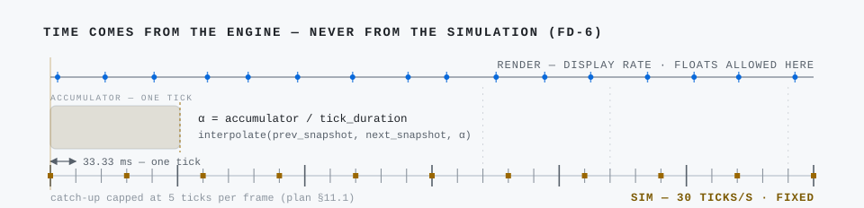
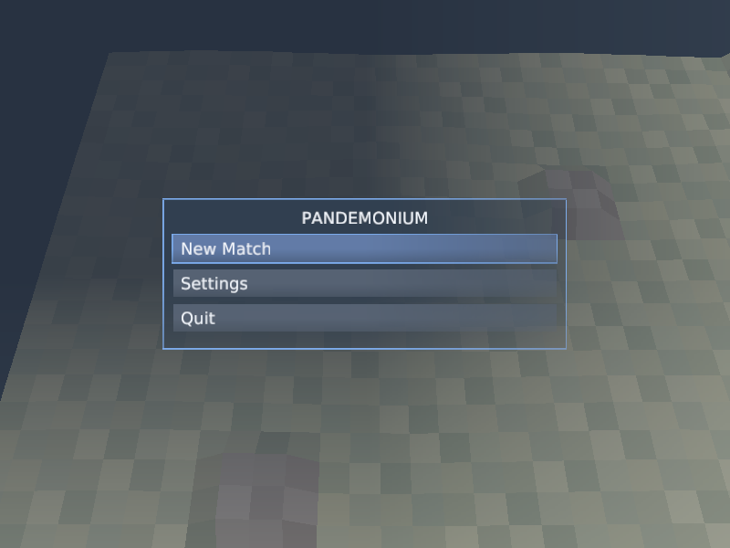
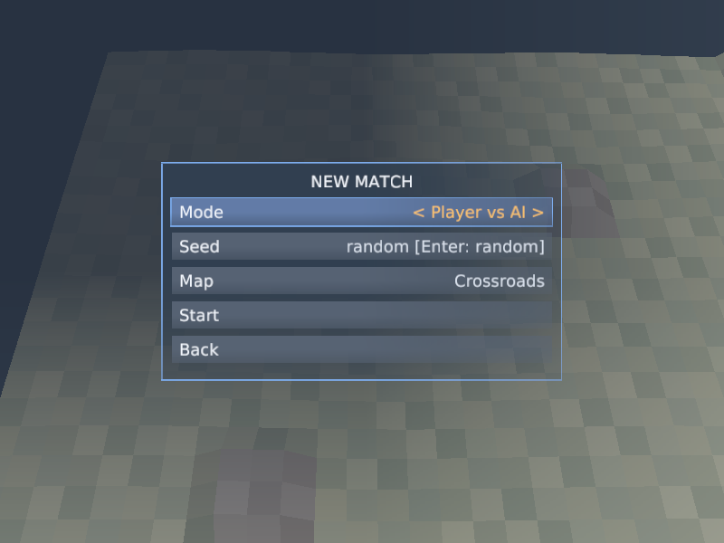
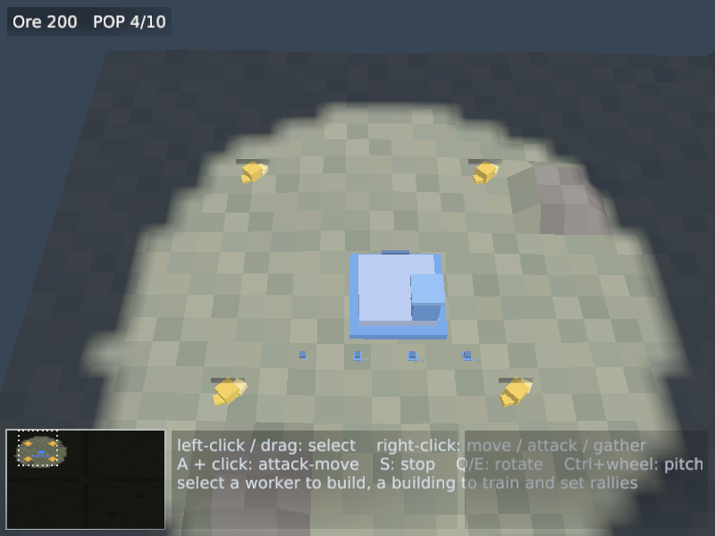
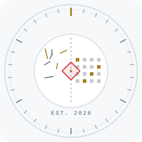

<div align="center">

<picture>
  <source media="(prefers-color-scheme: dark)" srcset="readme-assets/hero-dark.svg">
  
</picture>

# Pandemonium: Build & Destroy

**Build. Destroy. Replay. Verify.**

A deterministic real-time strategy foundation, written from scratch in Rust —
no game engine, no ECS framework, no off-the-shelf simulation. The loop, the
entity store, the fixed-point math, the replay codec: all of it is ours.

`30 Hz fixed tick` · `Q16.16 fixed-point` · `PCG32` · `xxHash64` · `9 crates, 0 floats`

[](https://github.com/E-Vex/pandemonium-bd/actions/workflows/ci.yml)

-9E6A03?labelColor=21262D)


*The name promises chaos. The simulation declines to deliver it.*

</div>

---

## The thirty-second brief

| | |
|---|---|
| **Determinism is the product** | A match is a seed, a content hash, and an ordered command log. Replay those three anywhere and every tick checksum must match — bit for bit, tick for tick. |
| **Everything is ours** | The game loop, the entity store, the Q16.16 fixed-point math, the PCG32 RNG, the xxHash64 state hash, the replay codec. No engine, no ECS, no shortcuts. |
| **Content is data** | Units, maps, factions, rulesets, missions: strict, versioned RON. Adding one touches zero lines of engine code (FD-4). |
| **Trust is enforced, not promised** | No floats, no unordered maps, no wall-clock, no OS entropy anywhere in the simulation — enforced by lints *and* a source-scanning test (FD-5). |

## The Guarantee

> **THE DETERMINISM GUARANTEE** — issued with every build, honored on every
> machine.
>
> 1. A match is exactly three things: **a seed, a content hash, and an ordered
>    log of commands.** Nothing else participates.
> 2. Replayed anywhere — any OS, any compiler, debug or release — **every
>    checkpoint checksum shall match**, tick for tick.
> 3. Units may scatter. **The simulation does not.** If two runs of the same
>    inputs ever differ, that is not a feature and not an edge case — that is
>    a defect, and you file it.
>
> *Sealed by three golden hashes, re-verified bit-identical on every push, on
> three operating systems, in both build profiles.*

## Disprove it in sixty seconds

Every claim above is falsifiable — that is the point. The fastest attempted
refutation of the Guarantee is a shell session:

```bash
git clone https://github.com/E-Vex/pandemonium-bd && cd pandemonium-bd

# fight a war nobody watches: 300 ticks, seed 7, every checkpoint printed
cargo run -p pandemonium-tools -- headless --seed 7 --ticks 300
#   final state hash: 0xb6fff6659cfb7709        <- the demo golden

# now prove the past: record the match, then re-simulate it
cargo run -p pandemonium-tools -- headless --seed 7 --ticks 300 --record demo.pdrp
cargo run -p pandemonium-tools -- replay-verify demo.pdrp
#   verify pass                                 <- the war happened twice, identically
```

Run it on the strangest machine you own. **The golden hash is a dare.** If
your run disagrees with it, you have not found an edge case — you have found
the most valuable bug report this project can receive.

## The War Machine

<p align="center">
<picture>
  <source media="(prefers-color-scheme: dark)" srcset="readme-assets/architecture-dark.svg">
  
</picture>
</p>

Nine crates, one law: **dependencies point downward only, and `sim` depends on
nothing above it.** [`tests/architecture_law.rs`](tests/architecture_law.rs)
makes breaking that a build failure, not a conversation.

| crate | role |
|---|---|
| [`fx`](crates/fx) | fixed-point math (`Fx`, `Vec2Fx`, `isqrt`), PCG32 RNG, xxHash64 hasher |
| [`sim_api`](crates/sim_api) | the boundary vocabulary: `Command`, `Event`, `Snapshot`, `PlayerView`, `Reject` |
| [`sim`](crates/sim) | the simulation: the 11-stage tick pipeline, stores, the command gate, the state hash |
| [`content`](crates/content) | RON schema, versioned loaders, validators, `ContentBundle` |
| [`ai`](crates/ai) | the scripted Alpha opponent — commands only, through a fog-filtered view |
| [`replay`](crates/replay) | the checksummed replay codec: record, load, verify |
| [`engine`](crates/engine) | game loop, interpolation, `MatchHost`, camera, mesh, renderer + audio seams |
| [`client`](crates/client) | the playable binary: wgpu + winit, 3D renderer, HUD, menus, audio |
| [`tools`](crates/tools) | headless runner, replay verifier, content validator, soak, bench |

The heartbeat, as a diagram:

<p align="center">
<picture>
  <source media="(prefers-color-scheme: dark)" srcset="readme-assets/timestep-dark.svg">
  
</picture>
</p>

Thirty ticks per second, every second, decoupled from rendering. The engine
interpolates between snapshots so the picture is smooth; the simulation never
learns what a frame rate is. All intent — player, AI, replay, future network —
enters through one validated `Command` gate at tick boundaries (FD-2). Parity
is a compile error, not a policy. The full specification is
[`plan.md`](plan.md); the code-as-built map is
[`docs/ARCHITECTURE.md`](docs/ARCHITECTURE.md).

## The Legion

One faction ships with the Alpha, and it is enough: **the Legion** — a
command center, four workers, one resource (200 ore in the bank), and victory
by elimination. Every number below is data in [`content/`](content), not code;
check it yourself with
`cargo run -p pandemonium-tools -- content-validate content`.

**The field roster**

| unit | doctrine | ore | pop | the numbers that matter |
|---|---|---:|---:|---|
| **Worker** | the economy — gathers ore, raises structures | 50 | 1 | 2.6 tiles/s |
| **Rifleman** | line infantry — holds the middle | 75 | 1 | dmg 8 · range 5.0 · 1.0 s reload |
| **Raider** | the flanker — arrives first | 60 | 1 | 4.0 tiles/s · dmg 6 · range 1.5 · 0.6 s reload |
| **Guardian** | the slow hammer | 200 | 3 | dmg 30 · range 8.0 · 2.0 s reload |
| **Turret** | static denial | 125 | 0 | dmg 10 · range 7.0 · 1.0 s reload |

**The infrastructure**

| structure | ore | provides |
|---|---:|---|
| **Command Center** | 400 | the HQ — trains Workers, +10 population |
| **Barracks** | 150 | trains the field roster: Rifleman, Raider, Guardian |
| **Supply Depot** | 100 | +10 population |

The Legion's sparring partner, **the Swarm**, is not a faction — it is an
instrument: the same roster at 1,000 starting forces per side, on the 128×128
Proving Grounds, for the 10× scale row. The stress test fights back
([`content_scale/`](content_scale)).

## Boot Camp

The toolchain is pinned to an exact Rust version by
[`rust-toolchain.toml`](rust-toolchain.toml); rustup installs it automatically
on first use.

```bash
# deploy
cargo run -p pandemonium-client                     # the windowed client, main menu first
cargo run -p pandemonium-client -- --frames 900     # windowed smoke: auto-exit with evidence
cargo run -p pandemonium-client -- --headless       # no display? honest fallback, no theater
cargo run -p pandemonium-client -- --version        # the build identity line
#   pandemonium-client 0.1.1 (git <sha>, content 0x9bc18c521107b262)
cargo run -p pandemonium-client -- --content PATH   # point at a content tree explicitly

# the gate — the same one CI runs on every push, on three OSes, in both profiles
cargo build --workspace --release
cargo fmt --all -- --check
cargo clippy --workspace --all-targets -- -D warnings
cargo test --workspace
cargo test --workspace --release     # determinism must hold in release too
```

The main menu starts a match (**Player vs AI / AI vs AI spectate / Sandbox**),
remembers your seed and map choices within the run, and persists settings
across runs — `edge_scroll`, `pan_speed`, `zoom_min`, `zoom_max`,
`master_volume`, `muted`, `fullscreen`, `debug_overlay` — a small `key=value`
file in your user config directory (per-OS locations:
[`docs/product/GAP_ANALYSIS.md`](docs/product/GAP_ANALYSIS.md) §11).
`--seed N` pre-fills the New Match screen's seed field; without it the seed is
random *and shown*, so you can still report it.

Audio degrades, never blocks: a machine with no output device gets one honest
startup line and a silent game; every other system runs normally
(`PANDEMONIUM_AUDIO_PROBE=0` skips the probe).

## The Field Manual

Controls follow **Generals: Zero Hour muscle memory** — the left hand of the
mouse selects, the right hand commands.

**Selection** — *left never issues an order*

| input | effect |
|---|---|
| <kbd>Click</kbd> / <kbd>Left-drag</kbd> | select / box-select |
| <kbd>Shift</kbd>+<kbd>Click</kbd> | add or remove one unit |
| <kbd>Shift</kbd>+<kbd>Drag</kbd> | add the box's picks |
| <kbd>Double-click</kbd> | select every visible unit of the same kind |
| <kbd>Esc</kbd> | clear the selection |

**Command** — *right is the only way to order*

| input | effect |
|---|---|
| <kbd>Right-click</kbd> enemy / ore node / ground | attack / gather (workers) / move |
| <kbd>Right-click</kbd> a single selected producer | set the rally point |
| <kbd>A</kbd> | arm attack-move for the next left-click |
| <kbd>S</kbd> | stop |

A click under 6 px of travel orders; a right-drag beyond that grabs and
scrolls the map instead, and the release then orders nothing.

**Camera**

| input | effect |
|---|---|
| <kbd>Right-drag</kbd> / <kbd>Middle-drag</kbd> | scroll / rotate |
| <kbd>WASD</kbd> / arrows / screen edges | pan |
| <kbd>Q</kbd> / <kbd>E</kbd> | rotate |
| <kbd>Wheel</kbd> / <kbd>Ctrl</kbd>+<kbd>Wheel</kbd> | zoom toward the cursor / tilt the pitch |

**Groups & jumps**

| input | effect |
|---|---|
| <kbd>1</kbd>–<kbd>9</kbd> / <kbd>Ctrl</kbd>+<kbd>1</kbd>–<kbd>9</kbd> | recall / assign a control group; double-tap centers on it |
| <kbd>Space</kbd> | jump to the last death — or your base |
| <kbd>Esc</kbd> | climb one rung per press: armed command → placement → selection → **pause menu** |
| <kbd>P</kbd> · <kbd>F3</kbd> · <kbd>F8</kbd> · <kbd>R</kbd> | pause · debug overlay · bug-report dump · rematch |

The tester-facing copy of this card — and the playtest protocol around it — is
[`docs/PLAYTEST.md`](docs/PLAYTEST.md).

## The Evidence

Real captures from the client (Xvfb + software GL, `master` `23012bf`) — the
main menu, the match setup screen, and a match in progress:

<p align="center">



</p>

| | |
|---|---|
| **Stage** | M10.2 complete — the Alpha awaits one thing: **A14, the human playtest** (five first-time tester slots, [`docs/PLAYTEST.md`](docs/PLAYTEST.md)) |
| **Tests** | 570+ automated, green in dev **and** release (the five should-panic invariants are debug-only) |
| **Platforms** | Linux · Windows · macOS — the full gate on every push, both profiles |
| **Goldens** | demo `0xb6fff6659cfb7709` · flagship `0x6e9a18bd7c5f699f` (seed 7 · 7,200 ticks · AI vs AI) · content `0x9bc18c521107b262` — bit-identical across every change |
| **In flight** | the mission system's first phase ([ADR-0201](docs/adr/0201-missions-campaigns-cutscenes.md)): Crossroads 01 — destroy the enemy command center |

The live status board is [`AI-Handoff.md`](AI-Handoff.md) — an out-of-date
handoff is treated as a bug. The Alpha's *system* properties are declared
proven with evidence in
[`docs/ALPHA_DECLARATION.md`](docs/ALPHA_DECLARATION.md); the playtest decides
the human half.

<details>
<summary><b>The Law — the ten frozen decisions (FD-1 … FD-10)</b></summary>

The constitution of the project ([`plan.md`](plan.md) §2). Changing one takes
an [ADR](docs/adr/README.md) with evidence — never a silent edit.

| | the law | what it buys |
|---|---|---|
| **FD-1** | deterministic fixed-tick simulation, 30 Hz, decoupled from rendering | a match = seed + content hash + command log; replays, soaks, lockstep multiplayer follow |
| **FD-2** | all intent enters as validated `Command` records at tick boundaries | one door for players, AI, replays, future network |
| **FD-3** | unified entity model: base record + capability blocks; 64-bit monotonic IDs, never reused | new entity types are data; systems iterate by capability, never by type name |
| **FD-4** | strict data/code boundary — stats, costs, maps, factions are versioned data files | add-a-unit and add-a-map require zero engine changes |
| **FD-5** | no floating point in the simulation or content — fixed-point / integer only | bit-identical results across OS, CPU, and compiler versions |
| **FD-6** | the simulation depends on nothing above it — no renderer, window, audio, clock, filesystem, OS entropy | the presentation layer is swappable without touching rules |
| **FD-7** | the AI plays through commands and a fog-filtered `PlayerView` | parity is structural, not a policy |
| **FD-8** | fog filters information; it never alters the simulation | replays and the AI stay honest |
| **FD-9** | events flow outward; presentation never polls sim internals | the feedback layer grows without sim changes |
| **FD-10** | the content schema only moves forward: versioned, validated, old content keeps loading | content survives years of growth |

</details>

## Reproducible incidents

A report that includes the seed and the tick is a **reproducible incident**;
anything else is a war story. The windowed client writes the report for you:
press <kbd>F8</kbd> at (or right after) the moment of the problem and it drops
a replay record (`pandemonium-report-<seed>-tick<tick>.pdrp`) plus a sidecar
`…-info.txt` carrying the seed, the tick, and the content identity. Attach
both files to the issue; the replay re-verifies headlessly:

```bash
cargo run -p pandemonium-tools -- replay-verify <file>
```

## The Intelligence Annex

| document | role |
|---|---|
| [`AI-Handoff.md`](AI-Handoff.md) | **start here** — the live status board, verification commands, hard-won gotchas |
| [`plan.md`](plan.md) | the authoritative spec (v2.0): FD-1..10, determinism rules, milestones, acceptance A1–A15 |
| [`docs/ALPHA_DECLARATION.md`](docs/ALPHA_DECLARATION.md) | the acceptance sweep A1–A15 with evidence; A14's open finding |
| [`docs/PLAYTEST.md`](docs/PLAYTEST.md) | the A14 instrument: protocol, controls card, tester schedule and results |
| [`docs/product/GAP_ANALYSIS.md`](docs/product/GAP_ANALYSIS.md) | the product-surface audit: the player journey vs the shipped client, and the ordered R1 gap list |
| [`docs/ARCHITECTURE.md`](docs/ARCHITECTURE.md) | the working map of the code as built |
| [`docs/CONTENT_GUIDE.md`](docs/CONTENT_GUIDE.md) | content authoring reference |
| [`docs/DEBT.md`](docs/DEBT.md) | every deliberate simplification, each with a repayment trigger |
| [`docs/ASSUMPTIONS.md`](docs/ASSUMPTIONS.md) | every interpretation that had to be guessed, numbered and cited |
| [`docs/adr/`](docs/adr/README.md) | the process for changing frozen decisions — ADR-0001 3D presentation · ADR-0002 audio backend · ADR-0100 app shell · ADR-0200 authoritative-vs-presentation data · ADR-0201 missions & campaigns |
| [`CHANGELOG.md`](CHANGELOG.md) | one entry per milestone |
| [`SECURITY.md`](SECURITY.md) | the declared threat model |

## The Workflow

Every change passes the green gate before commit — formatting, clippy with
zero tolerance, the full suite in both profiles. One logical change per
commit. Milestones are gates, not dates: M(N+1) does not start until every
exit test of M(N) is green in CI. Deliberate simplifications go to
[`docs/DEBT.md`](docs/DEBT.md) with a repayment trigger; guessed
interpretations go to [`docs/ASSUMPTIONS.md`](docs/ASSUMPTIONS.md);
challenges to frozen decisions go through an [ADR](docs/adr/README.md). Read
[plan.md §0](plan.md) — the operating contract — before the first commit. The
process is strict because the product is trust.

Contributions follow the same law as the code. Gameplay content is not
accepted while the Alpha content manifest is locked; bug reports — with seed
and tick — are welcome now, and unusually actionable.

## Licence

The project's own code and data are MIT-licensed — see [`LICENSE`](LICENSE).
Third-party components, including the embedded font, keep their own licences;
those terms are catalogued in `THIRD_PARTY_NOTICES.md` and ride in every
release archive.

---

<div align="center">

<picture>
  <source media="(prefers-color-scheme: dark)" srcset="readme-assets/seal-dark.svg">
  
</picture>

**Pandemonium: Build & Destroy** — by [E-Vex](https://github.com/E-Vex)

*Determinism under fire.*

</div>
