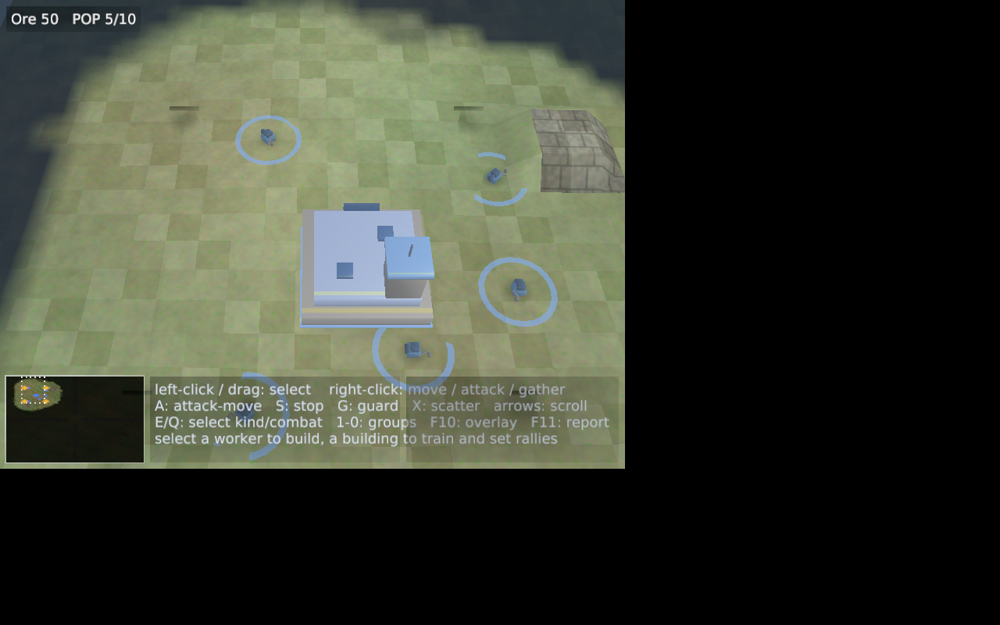
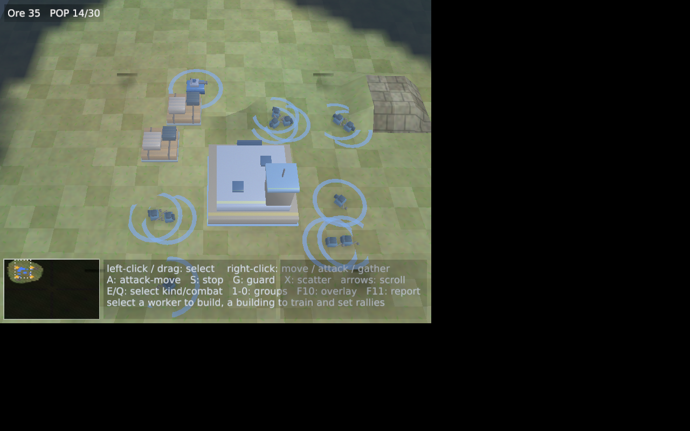
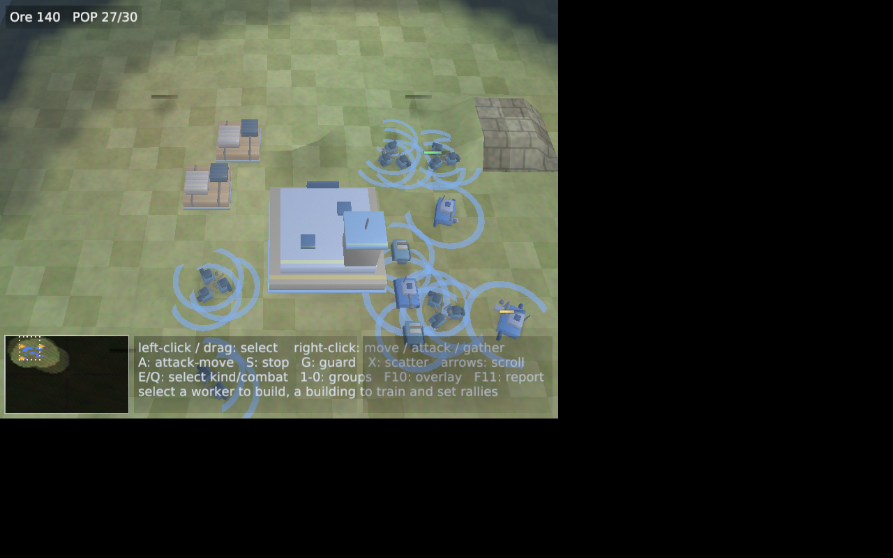

# A-018 — Task Report

**TASK ID:** A-018 — M12 phases 3-4: the renderer pass + the fallback chain · PRODUCT PHASE
**STATUS:** done (both phases landed green and live-verified; every acceptance criterion of the plan's §12 and all five amendments carry evidence; the STOP conditions were each checked and none triggered)
**Agent:** Programmer (Standing Orders v1.4)
**Branch:** `a/A-018-m12-render` (base: master `798aeb3`, the A-017 merge #56 — the brief's "after A-017 is merged" precondition; master did not advance during the task, no rebase needed)
**Date:** 2026-10-26

---

## 1. Summary

M12's model pipeline grew its renderer half: phase 3 draws real glTF meshes in place of the box silhouettes (instanced per-primitive per-kind draws from the same fog-filtered snapshot the boxes use, `METERS_PER_TILE = 3.0` living in `render/entities/mod.rs` per A-017 P1, the fixed glTF-to-entity orientation seam direction-pinned at yaw 0 and yaw 90 with its handedness proven, the manifest's `scale`/`rotation_deg`/`ground_offset` baked once at upload, the `team_color` base-color × player-color multiply on exactly the material the Designer named), and phase 4 builds each kind's presentation plan once at startup — model → skin → placeholder, lazily probed, with the A-146 pin made structural: at most ONE diagnostic line per failing kind per run, naming the tier it landed on, proven live by a full `--frames 900` run that greps the corrupted-rifleman diagnostic exactly once. The owner can see the models today: `scripts/make-pilot-pack.sh` builds a schema-2 pilot pack outside the repository from the three staged D-002 `.glb`s plus the official pack's skins as the fallback tier, and `cargo run -p pandemonium-client -- --pack <dir>` shows them — three Xvfb frames from a spectated match at the default camera (ore node, barracks, rifleman group) are attached below. ADR-0101 §4's example RON parses verbatim now (A-017 P2, A-153's two deltas fixed in the one line). 17 new tests (907 dev / 902 release, both green), the goldens bit-identical, zero sim files touched, and the branch was pushed after phase 3 exactly as the brief ordered, before a line of phase 4 existed.

## 2. Changes

Branch `a/A-018-m12-render`, 7 task commits before this report (one logical change each; the register commit is the single shared-doc commit per MP-3):

| Commit | One logical change |
|---|---|
| `bc9dca5` | `render/{entities/mod.rs,mod.rs,model.rs,pipeline/mod.rs}` — M12 phase 3, the model pass (orientation seam, METERS_PER_TILE, GPU conversion, pipeline, frame draws, evidence lines) |
| `d4f8b9c` | `scripts/make-pilot-pack.sh` — the D-002 pilot pack builder (amendment 3) |
| `b0b4b28` | `docs/adr/0101-model-pipeline.md` — §4's example RON parses verbatim (amendment 2, A-017 P2) |
| — *pushed here* — | the phase-3 boundary the brief's amendment 4 ordered |
| `325d105` | `pack/mod.rs` + `render/{mod.rs,pipeline/mod.rs,texture.rs}` — M12 phase 4, the fallback chain + the one-diagnostic guarantee |
| `ee8e93f` | `tests/xvfb/a018_m12_models.sh` + `docs/pm/reports/a018-frames/` — the machine pass + the three frames (amendment 5) |
| `cbf6f05` | `docs/ASSUMPTIONS.md` — A-156…A-160 (the one register commit) |
| (final) | `docs/pm/reports/A-018.md` — this report (MP-9) |

Zero sim-tree, content, workflow, or `pandemonium-assets` files touched. Two files outside the brief's declared list carry **minimal mechanical** edits, flagged here and under §6 D1: `render/pipeline/mod.rs` (the constructor's call site — one call plus field moves; the phase-4 commit additionally deleted the skin loop the chain replaced) and `render/texture.rs` (the now-dead `resolve_kind_textures` and its two plan tests removed — clippy's `-D warnings` leaves no choice when the sole caller goes). The declared list is otherwise satisfied exactly — see MP-1 at the end.

## 3. Evidence per acceptance criterion

**3.1 Phase 3 — the renderer pass (A-016 §12) — LANDED.**

- **Direction-pinned tests, yaw 0 and yaw 90 (the M9.1 lesson) — LANDED as pure functions.** The seam lives in `render/entities/mod.rs`: `bake_gltf_to_entity` (the fixed `(x, y, z) → (−z, y, x)` basis) and `entity_yaw_rotate` (the correct-handed yaw — the transposed convention `build_entity_instances` maps part offsets with, deliberately NOT the box shader's mirrored form). Five tests pin it: yaw 0 (the baked glTF forward lands on east, where a facing-(1,0,0) unit's yaw is 0), yaw 90 (the same forward lands on north at the atan2-defined π/2), the right/up convention against the `a_facing_turn` test's own law (an east-facing model's right side is +Z; a north-facing one's is −X — exactly where that test watches a rifleman's right-hand carry land), the bake's handedness (cross(baked Y, baked Z) = baked X — a proper rotation, never a mirror), and the full placement order (rotate → scale → ground_offset → ÷METERS_PER_TILE → bake, per A-144).
- **A headless-constructible pipeline test (fixture `.glb` → GPU-ready buffers → instance stream for N entities) — LANDED.** `model_pass_tests` builds hand-assembled GLB fixtures and drives the pure half of the pipeline with no GPU: `a_fixture_glb_becomes_gpu_ready_buffers_headless` (load → `gpu_primitives` → the first corner asserted in tiles on the entity basis at ±1/6, indices/uvs passed through, the team flag and material factor riding every vertex), `the_manifest_placement_bakes_in_the_documented_order`, `a_normalless_primitive_gets_flat_normals` (true per-triangle face normals, vertices duplicated, indices dropped), `a_textured_material_carries_its_png_and_a_white_factor` (the skin path's discipline generalized), `embedded_pngs_decode_under_the_skin_guards`, and the instance-stream set: `model_kinds_draw_one_instance_per_entity_and_skip_their_boxes` (one instance per entity, contiguous per-kind runs, yaw from facing, team colors, the boxes gone for model kinds), `selection_brightens_a_models_team_color`, `the_model_stream_respects_the_capacity` (whole-entity clipping), `without_models_both_paths_stay_untouched`.
- **The placeholder and skin paths unchanged for kinds without models — GREEN.** Every pre-existing render test still passes (the `build_instances` signature grew the `kind_renders_model` table; an empty table is behaviorally the old function — the no-pack and skins-only cases are pinned by `without_models_both_paths_stay_untouched` and the whole prior suite), and the live official v1 pack run below is the unchanged-skin path on real data.
- **Xvfb windowed smoke with a one-model test pack: model-loaded evidence line + rendered frame vs placeholder — LANDED.** Machine pass c1 (below) runs the one-model pack (`make-pilot-pack.sh rifleman`): exactly the `entity model 'rifleman' loaded (3 primitives, 432 triangles, …)` line, the other kinds on their skins, 300 frames presented. The frame-vs-placeholder look: the c4 timeline frames + the three attached below — machine-verified as live renders with distinct pixels, and read by a vision model (the ore node's rock formation, the barracks' detailed 3D structure with blue team-color trim, clusters of small detailed humanoid figures) — but the *look* is "needs owner eyes" per STANDING_ORDERS §8, and §11 asks for exactly that re-test.
- **Both-profile suite green; goldens bit-identical** — §4 and §5.

**3.2 Phase 4 — the fallback chain and the one-diagnostic guarantee (A-016 §12) — LANDED.**

- **Fixture packs — LANDED as pure chain tests plus live runs.** `pack/mod.rs` gained the chain as a pure, unit-pinned rule — `AssetPack::resolve_presentation(kind, model_outcome, skin_outcome)` walks model → skin → placeholder, and `presentation_diagnostic` formats the ONE line — with six tests over real on-disk fixtures: corrupt `.glb` + valid skin → the skin tier, exactly one failure, the line asserted character-for-character; corrupt model + no skin → the placeholder tier, one line; a missing model file → a recorded `PackNote` (deferred, nothing printed at pack load) riding the same single line while the skin survives; both tiers failing → two reasons, still ONE line (A-154's interim double-print, now impossible); a clean model → no diagnostic and the skin never probed (the laziness, pinned at the rule level); icon/sound misses → the same single line naming the model tier.
- **A full `--frames 900` run with a bad model greps exactly one occurrence of the diagnostic — PROVEN LIVE (machine pass c2).** The corrupted-rifleman pack (garbage `.glb` bytes over the valid skin, built by the machine pass from the pilot pack) across 900 presented frames: `entity 'rifleman'` appears in exactly **1** diagnostic line — `pandemonium pack: entity 'rifleman' — model 'models/units/rifleman.glb' could not be loaded (not a GLB container …); rendering the PNG skin tier` — the skin still loads (`entity skin 'rifleman' loaded`), the other models (barracks, ore_node) and all six skins load untouched, and no other `pandemonium pack:` line exists in the log. **Zero diagnostics in the frame path is the same grep**: one occurrence across 900 frames *is* the proof that no per-frame log call exists (a per-frame logger would print it ~900 times); the plan's belt-and-braces reading is satisfied by the same evidence line count.
- **Every other kind's assets still render — PROVEN.** c2's checks enumerate the other kinds' positive lines; c3 repeats the shape for the model-only kind (a corrupted `ore_node.glb` with no skin declared → one line naming the placeholder silhouette tier, barracks + rifleman untouched, 300 frames).
- **Amendment 1, second half — the per-reference diagnostics unified under the A-146 pin (A-017 P3) — LANDED.** `resolve_ref` now records deferred `PackNote`s for v2 entity references (model/skin/icon/sounds) instead of printing; the renderer's single resolution folds every note for a kind into that kind's one line. v1's whole-entry skip and every terrain miss keep their direct one-line prints (pinned behavior; a kind with one reference can never double) — and the live official-pack run in §4 shows the v1 path byte-identical to A-017's evidence.

**3.3 The brief's amendments — LANDED.**

1. **`METERS_PER_TILE = 3.0` lives in `render/entities/mod.rs`** (A-017 P1): the one named constant, imported by the conversion and cited by the shader's comments; nothing else in the client multiplies a world unit by it. The diagnostics unification is §3.2's last bullet.
2. **ADR-0101 §4's example RON parses verbatim** (A-017 P2): the `sounds` line now uses the plain `"SelectionClick": "audio/rifleman/select.ogg"` map form, with A-153's two deltas named in a note beneath the example so the record keeps its history.
3. **`scripts/make-pilot-pack.sh`** — builds the schema-2 pilot pack outside the repository (default `/tmp/pandemonium-pilot-pack`, `PILOT_OUT` to move it) from the three staged D-002 `.glb`s (rifleman + its skin, barracks + its skin, ore_node model-only — the official pack ships no ore_node skin, so the placeholder is that kind's fallback tier, exercising the whole ladder), plus all eight official skins and the four terrain classes, read-only: the official pack itself is untouched and stays schema 1 (live-verified in §4). A kinds filter builds the one-model variant (`make-pilot-pack.sh rifleman`). `cargo run -p pandemonium-client -- --pack /tmp/pandemonium-pilot-pack` loads it: `asset pack 'pilot_d002' (schema 2) loaded`, three model lines, six skin lines, zero diagnostics (machine pass c0, 900 frames).
4. **Pushed after phase 3** — the branch's first push carried exactly the phase-3 commits (`bc9dca5`, `d4f8b9c`, `b0b4b28`) with the phase-4 green gate behind them; not a line of phase 4 existed in the tree at that push. The PR description carries the what-to-try list.
5. **Three Xvfb frames attached** — `docs/pm/reports/a018-frames/`: the ore node at the opening (top right, the grey rock with amber crystals), the pair of barracks models once the AI built them (detailed 3D structures with blue team-color trim — the `team_color` multiply visible as P0 blue on the authored white material), and a rifleman group rallying (clusters of small detailed figures). All three come from the c4 timeline: a spectated AI-vs-AI match on the pilot pack, the default camera untouched, one dated frame every 15 s (16 frames, all pixel-distinct, the match ran to tick 7445). The frame selection below the machine's pixel-variance proof was machine-assisted (a vision model read the frames and quadrants) — stated honestly: the look needs the owner's eyes, §11 item 1.

**3.4 The brief's STOP conditions — CHECKED, NONE TRIGGERED.**

- *A golden moves* — no: §5 (all four re-derived bit-identical at tip, in both the tool runs and the live client's own content-hash line).
- *Any sim file is touched* — no: the diff (MP-1) is `crates/client` render/pack files, the two flagged mechanical files, the script, the machine pass, and docs; the `determinism_source_bans` scan set is untouched and the architecture-law suite is green.
- *Anything logs per frame* — no: §3.2's live proof (one occurrence across 900 frames); structurally, every `println!`/`eprintln!` in the new code sits inside the constructor's one-time walk.
- *No Rust toolchain here* — not triggered: like A-017, the exact pinned toolchain (rustup, 1.98.1, rustfmt + clippy, minimal profile) was installed before any code was written, and every claim in this report ran on it.

## 4. Gate results

**Re-run in this environment, green at branch tip** (the pinned 1.98.1 toolchain; the ALSA/EGL userland extracted without root per AI-Handoff §9):

- `cargo fmt --all -- --check` — PASS
- `cargo clippy --workspace --all-targets -- -D warnings` — PASS
- `cargo test --workspace` — **907 passed, 0 failed** (master baseline: 890; +17 = 13 model-pass tests, +6 chain tests, −2 retired texture-plan tests)
- `cargo test --workspace --release` — **902 passed, 0 failed** (master baseline: 885; +17)
- `content-validate content --expect-content-hash 0x9bc18c521107b262 --expect-map-id 0xd38136401ab02ff1` — PASS
- `headless --seed 7 --ticks 300` → `0xb6fff6659cfb7709` — PASS (bit-identical)
- `headless --seed 7 --ticks 7200 --p1 ai --p2 ai` (release) → `0x6e9a18bd7c5f699f` — PASS (bit-identical)
- The client's own `--headless` smoke — `smoke PASS`, content hash `0x9bc18c521107b262` on the same line it always prints
- **Windowed, official v1 pack, Xvfb + llvmpipe** (the pack fetched by `fetch-assets.sh` into the dev layout): `asset pack 'tactical_field' (schema 1) loaded` — the release smoke's exact grep target (`release.yml:573`), byte-identical to A-017's evidence — and 120 frames presented clean
- **The A-018 machine pass** (`tests/xvfb/a018_m12_models.sh`): **5/5 checks PASS** — c0 (pilot pack, three models, lazy chain, zero diagnostics, 900 frames), c1 (one-model pack), c2 (the A-146 live proof), c3 (the placeholder tier), c4 (the 16-frame spectate timeline); evidence in `target/a018-evidence/`

## 5. Goldens

**Unchanged — bit-identical, re-derived live at branch tip.** Content `0x9bc18c521107b262`, map id `0xd38136401ab02ff1`, demo `0xb6fff6659cfb7709`, flagship `0x6e9a18bd7c5f699f`. Structurally guaranteed and now observed twice over: the content hash covers `content/` only, the pack and the client's presentation tree never enter any hashed state (ADR-0200 §2/§3), and the diff touches no sim-tree file. No stop condition of §7 was approached.

## 6. Deviations and assumptions

Five register rows, A-156…A-160 (`docs/ASSUMPTIONS.md`, commit `cbf6f05`): the orientation seam's exact math with its handedness proof (A-156); what the model tier replaces and what it keeps — shadows, rings, death fades, no squatting (A-157); probe totality and the loader's 20th precise rejection `AttributeCountMismatch` (A-158); the one-diagnostic unification's scope, including the honest silence of unconsumed notes in headless runs (A-159); cull-off and the single mid specular (A-160). Two in-report deviations:

- **D1** — Two files outside the declared touch list carry minimal mechanical edits: `render/pipeline/mod.rs` (the constructor had to call `build_model_pass` and move its result into the struct — phase 3 added one call plus five field moves; phase 4 replaced the skin loop with the chain's call, a net deletion there) and `render/texture.rs` (`resolve_kind_textures` and its two plan tests removed with their now-dead caller; the declared-vs-renderable distinction they pinned is owned by the chain suite, reading the typed fields per A-155). Standing Orders §3's minimal-mechanical-change allowance, flagged here and in MP-1.
- **D2** — The plan's phase-3 acceptance said "a one-model test pack"; the brief's amendment 3 ordered the pilot pack with three models. Both were run: c1 is the strict one-model pack (the letter), c0/c2/c3 the full pilot pack (strictly more coverage). No behavior difference — the same builder, a kinds filter apart.

## 7. New debt

None opened. No `DEBT-` ids created; nothing inside the brief's scope was simplified past its letter. The deliberate deferrals are the plan's own (icon/sound consumption, skeletal animation, the docs truth pass — phase 5 and later briefs).

## 8. Risks and surprises

- **The world is left-handed where it matters.** The renderer's world (x-east, y-up, z-north) makes rotations about +Y clockwise from above — which is why the box shader's rotation reads "mirrored" and why the correct model yaw needed the transposed form. The seam is now pinned by name at four angles plus handedness (A-156), but the owner's eyes on a moving model group are the real test that the *feel* is right — §11 item 1.
- **The phase-3 interim state existed exactly one push.** Between the phase-3 push and the phase-4 commit, a kind with a failing model AND a failing skin printed two lines (A-154's interim state, by then reading the typed fields). The phase-4 commit closed it; the branch's final state is what merges.
- **python-xlib's XTEST entry point is `fake_input`, not `xtest_fake_input`** (the a013 script's spelling, this version's API). The first c4 run died on it silently behind the log filter; the fixed script keys through the server's own keysym-to-keycode map. Worth knowing for the next machine pass.
- **A spectated match is the only input-free way to put riflemen on screen**, and they take a minute or two to exist (the AI builds the barracks first). The c4 timeline runs four minutes to be safe; if a future pass wants this faster, §9 P2.
- **The three frames were selected machine-assisted**: the machine proved the frames live (pixel variance, all 16 distinct, the match's tick counter advancing), and a vision model read them to find the ore node, the barracks, and the rifleman clusters — but "looks right" is the owner's call, and the report says so rather than claiming a human looked.
- **`AttributeCountMismatch` widened the loader's rejection set** (A-158): a hand-crafted file whose NORMAL/TEXCOORD_0 count disagrees with POSITION now fails at load instead of panicking in the conversion. Blender exports always agree, so no real delivery path changes.

## 9. Proposals (not implemented)

- **P1** — At the next ADR-0101 docs touch (phase 5's truth pass is the natural vehicle), add one paragraph to §6 recording the exact seam now pinned in A-156 — the `(x,y,z) → (−z,y,x)` bake, the correct-handed yaw, and the left-handed-world finding that motivates both — so the ADR's "−Z → forward" carries the implementation's exact math, not just its intent.
- **P2** — The c4 timeline costs ~10 minutes under llvmpipe because a spectate run has no `--frames`-style auto-exit. A future brief could add a spectate-aware exit budget (the client already has the `--frames` machinery), halving the machine pass's wall time.
- **P3** — The machine pass rebuilds the pilot pack from the assets repo's default URL on every run. If CI ever adopts it, an `A018_ASSETS_REF` pin (the env knob the script already threads) should name the D-002 delivery commit so the pack contents are reproducible bit-for-bit.

## 10. Cross-lane requests

None — everything in the brief sat inside the declared touch list plus D1's two mechanical files. The assets repo was read-only throughout (its `design/staging` tree and official pack copied out by the script, never written); the upstream gltf-rs report (A-017 §11 item 3) remains an owner-side courtesy, unchanged.

## 11. Needs from owner

1. **The eyes pass**: the three attached frames, and ideally a real-machine run with `scripts/make-pilot-pack.sh && cargo run -p pandemonium-client -- --pack /tmp/pandemonium-pilot-pack` (start a match, watch riflemen walk, build a barracks, click an ore node). The machine proved the models load, render, and face their headings by test; the *look* is yours per STANDING_ORDERS §8 — rotation feel, model scale against the terrain, and the team-color read on the barracks trim are the three things to judge.
2. **The `AI-Handoff.md` sync** (the M12 status row: phases 0-4 done, phase 5 pending; the register counts A-156…A-160) — outside this brief's touch list, so it needs the same one-brief authorization A-017 got; the phase-5 brief is the natural carrier.
3. **The phase 5 brief** (the truth pass: `docs/ASSETS.md`'s models row and the retired "no GLB loading" sentence, `docs/ARCHITECTURE.md`'s render-map row, the first real delivery through the Standing Orders path).
4. Optional, still open from A-017: the upstream gltf-rs validator-panic report (A-017 §8/P4).

## MP-1 — touch list

Declared (the brief):

```
render/entities/mod.rs, render/mod.rs, render/model.rs, the render shader
files, pack/mod.rs, scripts/make-pilot-pack.sh, tests/,
docs/adr/0101-model-pipeline.md, docs/ASSUMPTIONS.md,
docs/pm/reports/A-018.md.
```

Actual (`git diff --name-only master...HEAD` at the final commit):

```
crates/client/src/pack/mod.rs
crates/client/src/render/entities/mod.rs          (declared; also the model shader's home)
crates/client/src/render/mod.rs
crates/client/src/render/model.rs
crates/client/src/render/pipeline/mod.rs          (D1: the constructor call site, mechanical)
crates/client/src/render/texture.rs               (D1: the dead resolver removed, mechanical)
docs/ASSUMPTIONS.md
docs/adr/0101-model-pipeline.md
docs/pm/reports/a018-frames/barracks-default-camera.png     (the report's attached frames,
docs/pm/reports/a018-frames/ore-node-default-camera.png      amendment 5)
docs/pm/reports/a018-frames/rifleman-group-default-camera.png
docs/pm/reports/A-018.md                          (this report, MP-9)
scripts/make-pilot-pack.sh
tests/xvfb/a018_m12_models.sh                     (tests/)
```

Every declared file touched, exactly two undeclared files, both flagged under §6 D1 as minimal mechanical changes. The render shaders live as embedded WGSL in `render/entities/mod.rs` (the house pattern — the new `MODEL_SHADER_SRC` sits beside `ENTITY_SHADER_SRC`), so "the render shader files" resolve to that declared file. No sim-tree file, no content file, no workflow, no golden pin moved.

---

### The three frames (amendment 5)

| The ore node at the opening | The barracks, once built | A rifleman group |
|---|---|---|
|  |  |  |

All three: a spectated AI-vs-AI match on the pilot pack, the default camera untouched, captured under Xvfb + llvmpipe by `tests/xvfb/a018_m12_models.sh` c4 (frames 00, 05, and 12 of the timeline). The ore node sits top-right of the opening frame; the pair of barracks (grey concrete, blue team-color trim) stand left of the command center; the riflemen rally in clusters of small detailed figures.
